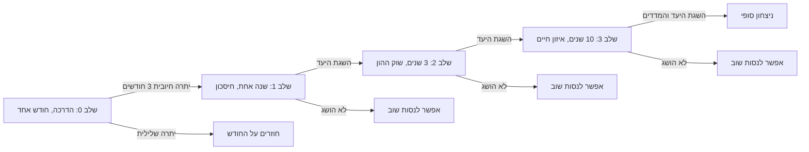

# Level Design: החיים הם ההשקעה (Life Capital)

## 1. רקע מהמחקר ומקהל היעד

- **קהל ראשי:** בני נוער בגילאי 13–18 שרוצים להכיר את עולם הכסף וההשקעות.
- **קהל משני:** מבוגרים צעירים שמתחילים לנהל כסף לבד.
- **מה מניע אותם:** סקרנות לגבי כסף, תחושת שליטה בחיים דמיוניים, ולמידה בלי להרגיש שמלמדים.
- **מתחרים:** BitLife (חיים בלי עומק כלכלי), The Stock Market Game (בורסה בלבד), Virtonomics (ניהול עסקים), Student Stock Trader (מניות בלבד).
- **הבדל שהשלבים צריכים להציג:** הכסף הוא חלק מחיים שלמים, יחד עם עבודה, הוצאות, השכלה וקשרים.

**מה מזה נובע לתכנון השלבים:** כל שלב מוסיף נושא כלכלי אחד בכל פעם. המשוב על כל החלטה צריך להיות ברור, כי הקהל צעיר.

**הערה חשובה:** המשחק מלמד הבנה כללית (גיוון, זמן, הוצאות), ולא נותן ייעוץ השקעות אמיתי. חשוב להציג את זה בבירור בתפריט הפתיחה, כדי שלא ייראה כייעוץ.

---

## 2. סקירת השלבים

| שלב | סוג | נושא כלכלי | משך במשחק | יעד לניצחון | אירועים |
|---|---|---|---|---|---|
| 0 | הדרכה | תקציב חודשי: הכנסה מול הוצאה | חודש אחד | יתרה חיובית לשלושה חודשים | אין |
| 1 | קל | חיסכון והשקעה פשוטה (חשבון חיסכון) | שנה אחת | שווי נקי מסוים | אירוע אחד: יום הולדת |
| 2 | בינוני | שוק ההון, תנודתיות ושינוי מקצוע | שלוש שנים | שווי נקי גבוה יותר | אירוע שוק: ירידה חדה |
| 3 | קשה | פיזור השקעות, חובות ואיזון חיים | עשר שנים | שווי נקי, ומדדי חיים מעל סף | שוק קורס, משפחה, השכלה |

---

## 3. פירוט כל שלב

### שלב 0: הדרכה
- **מטרה:** השחקן מבין שההכנסה צריכה לכסות את ההוצאות, ושהיתרה נשמרת לאורך זמן.
- **מה קורה:** השחקן מקבל משרה בסיסית. מוצגים לו: שכר חודשי, שכירות, אוכל, ותנועה. הוא צריך לסיים חודש עם יתרה חיובית.
- **משוב:** בכל סוף חודש, מוצג הסבר קצר על מה קרה.
- **ניצחון:** יתרה חיובית שלושה חודשים ברצף.

### שלב 1: קל
- **מטרה:** השחקן לומד חיסכון והשקעה פשוטה.
- **מה קורה:** השחקן חוסך אחוז קבוע מהשכר לחשבון חיסכון, ורואה ריבית קטנה. באמצע השנה מופיע אירוע: יום הולדת, שבו השחקן צריך לבחור בין מתנה יקרה לחיסכון.
- **ניצחון:** שווי נקי מסוים בסוף השנה.

### שלב 2: בינוני
- **מטרה:** השחקן לומד שהשקעה במניות עולה ויורדת, ושהחלטה לוקחת בחשבון את הזמן.
- **מה קורה:** שוק ההון נפתח. יש תנודתיות, וגם אירוע שוק שבו המחירים יורדים בחדות. מופיעה אפשרות לשנות מקצוע, עם שכר גבוה יותר והוצאות גבוהות יותר.
- **ניצחון:** שווי נקי מסוים אחרי שלוש שנים.

### שלב 3: קשה
- **מטרה:** השחקן מנהל כמה נכסים, חובות, ומשפחה, תוך איזון בין כסף לחיים.
- **מה קורה:** השחקן יכול לפזר השקעות בין חיסכון, מניות ונכס. יש הלוואה שצריך להחזיר. אירוע קריסת שוק מגיע באמצע, ובאותו זמן יש החלטה משפחתית.
- **ניצחון:** שווי נקי מסוים, ומדדי חיים (בריאות, קשרים) מעל סף מינימלי. כך נלמד שאי אפשר לאזן רק בכסף.

---

## 4. דיאגרמה: מעבר בין שלבים



---

## 5. דיאגרמה: ציר הזמן של שלב 2

```
שנה 1      שנה 2           שנה 3
|----------|---------------|---------------|
  חודשים     אירוע שוק:       שינוי מקצוע
  רגילים     ירידה חדה        (אפשרות)
             [בדיקה: לא למכור בפאניקה]
```

---

## 6. מה כבר ממומש ומה עוד מתוכנן

- **עדיין לא ממומש.** זה תכנון לשלבים של Life Capital.
- **הצעד הבא:** לבנות את שלב 0 כאב-טיפוס: חודש אחד, שכר, שלוש הוצאות, ויתרה.

---

## 7. בדיקה מול משתמשים

- לבדוק את שלב 0 עם 3–5 תלמידים בגילאי 13–18, ולשאול: האם הבנתם למה נשארה לכם יתרה שלילית?
- לתקן: אם הם לא מבינים את המשוב, לכתוב אותו בשפה פשוטה יותר.
