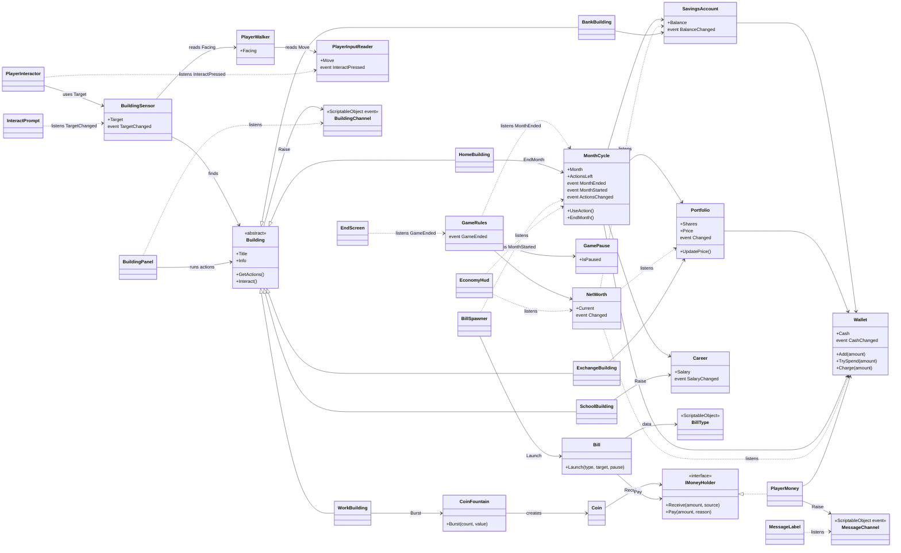

# 🎮 Life Capital - החיים הם ההשקעה

> *Every decision today shapes your financial future.*

משחק סימולציה כלכלית ב-Unity. השחקן בן 18, עם 10,000 מטבעות ועבודה ראשונה. בכל חודש הוא מסתובב בעיר, בוחר שלוש פעולות (עבודה, לימודים, חיסכון או מניות), מתחמק מהוצאות בלתי צפויות, וחוזר הביתה כדי לסיים את החודש. המטרה: להגיע לשווי נקי של 45,000 בתוך 12 חודשים.

המשחק מלמד מושגים כלליים (תקציב, חיסכון, סיכון, השקעה בהשכלה) עם מספרים מומצאים. הוא אינו ייעוץ השקעות.

**קישורים**

- שחקו בדפדפן (itch.io): https://adisagi.itch.io/life-capital
- תכנון המשחק: [רכיבים רשמיים](homework_financial_conduct_game.md), [מחקר שוק](Market_Research_Life_Capital.md), [תכנון שלבים](Level_Design_Life_Capital.md)

**צוות:** שגיא רהט, עדי פלצקי.

---

## מה ממומש בשלב הזה

מטלה 4 מבקשת את תהליך הליבה ברמה אחת, עם צורות פשוטות. מימשנו את "שלב 1" מתכנון השלבים (שנה אחת), עם לולאת הליבה המלאה:

1. **מסתובבים בעיר** ונכנסים לבניינים (עומדים מול בניין ולוחצים E).
2. **שלוש פעולות בחודש:**
   - **Work:** שעות נוספות. המשכורת הנוספת עפה מהבניין כמטבעות, וצריך לאסוף אותן לפני שהן נעלמות.
   - **School:** קורס עולה 5,000 עכשיו ומעלה את המשכורת ב-700 בכל חודש.
   - **Bank:** הפקדה לחיסכון עם ריבית קטנה ובטוחה.
   - **Stock Exchange:** קנייה ומכירה של מניות. המחיר משתנה פעם בחודש, למעלה או למטה.
3. **הוצאות בלתי צפויות:** מהחודש השני רודפים אחרי השחקן חשבונות אדומים. חשבון שנוגע בשחקן משולם מיד.
4. **Home:** סיום החודש. מקבלים משכורת, משלמים הוצאות מחיה, החיסכון צובר ריבית ומחיר המניה מתעדכן.

**ניצחון:** השווי הנקי (מזומן + חיסכון + שווי המניות) הגיע ל-45,000 בסוף חודש.
**הפסד:** החודש ה-12 נגמר בלי להגיע ליעד, או שלושה חודשים רצופים שהסתיימו במינוס.

| פעולה | מחשב | טלפון |
|---|---|---|
| תזוזה | חצים או WASD | ג'ויסטיק בפינה השמאלית התחתונה |
| כניסה לבניין | E או רווח | כפתור Enter בפינה הימנית התחתונה |

---

## איך מריצים

1. מתקינים Unity `6000.6.7f1` (עם מודול Web).
2. משכפלים את הריפו ופותחים את התיקייה ב-Unity Hub (Add ← Add project from disk).
3. פותחים את הסצנה `Assets/Scenes/Menu.unity` ולוחצים Play.

הסצנות, הפריפאבים וקובצי הנתונים נוצרים על ידי הכלי **Tools ← Life Capital ← Create Everything**. הם כבר נמצאים בריפו, ואפשר להריץ את הכלי שוב כדי לבנות אותם מחדש.

לבניית גרסת הדפדפן: **Tools ← Life Capital ← Build WebGL**. התוצאה נשמרת בתיקייה `Builds/WebGL`.

---

## פיסיקה במשחק (מטלה 4, חלק א)

המשחק הוא "2.5 ממדים": התמונה דו-ממדית (ספרייטים, מבט מלמעלה), והפיסיקה היא המנוע התלת-ממדי של Unity. כל הגופים נעים במישור X-Y.

| תכונה | איפה בקוד | מה היא עושה במשחק |
|---|---|---|
| בקר דמות קינמטי `CharacterController` | `Player/PlayerWalker.cs` | השחקן זז בדיוק לפי הקלט (`Move`) ומחליק לאורך קירות ובניינים. כוחות לא מזיזים אותו. אין כוח כבידה כי המבט מלמעלה |
| גוף קשיח `Rigidbody` | `World/Coin.cs`, `Hazards/Bill.cs` | המטבעות והחשבונות הם גופים דינמיים שמתנגשים בקירות וזה בזה |
| כוחות `AddForce`, `AddTorque` | `World/CoinFountain.cs`, `Hazards/Bill.cs` | מטבע מקבל דחיפה וסיבוב חד-פעמיים (`VelocityChange`). חשבון נדחף אל השחקן בכל צעד פיסיקלי, והריסון של הגוף קובע את המהירות הסופית שלו |
| הטלת כדור `SphereCast` | `Player/BuildingSensor.cs` | כדור קטן מוטל קדימה מהשחקן כדי למצוא את הבניין שמולו |
| טריגרים `OnTriggerStay`, `OnTriggerEnter` | `Coin`, `Bill` | איסוף מטבע ותשלום חשבון כשהם נוגעים בשחקן |

שאר התכונות מהשיעור (`Rigidbody2D`, `Raycast` דו-ממדי, ו-`Collision2D` עם `relativeVelocity`) ממומשות במשחק השני שלנו, [הראיון הבא](https://github.com/SagiAdi/The-Next-Interview-Game).

---

## ארכיטקטורה (מטלה 4, חלק ב)

### מבנה התיקיות

```
Assets/
├── Scripts/
│   ├── Player/      PlayerInputReader, PlayerWalker, BuildingSensor, PlayerInteractor, PlayerMoney
│   ├── Economy/     Wallet, SavingsAccount, Portfolio, Career, MonthCycle, MonthReport, NetWorth, IMoneyHolder
│   ├── Game/        GameRules, GameResult, GamePause
│   ├── World/       Building, BuildingAction, HomeBuilding, WorkBuilding, SchoolBuilding,
│   │                BankBuilding, ExchangeBuilding, Coin, CoinFountain
│   ├── Hazards/     Bill, BillSpawner
│   ├── UI/          EconomyHud, BuildingPanel, MessageLabel, InteractPrompt, EndScreen, MenuScreen,
│   │                TouchControls, VirtualJoystick, UIBuilder
│   ├── Events/      EventChannel, MessageChannel, BuildingChannel
│   ├── Data/        EconomySettings, StockData, BillType  (מחלקות ScriptableObject)
│   ├── Animation/   SpriteAnimator, WalkAnimationDriver
│   └── Utils/       Placeholder, PlaceholderArt
├── Data/            קובצי הנתונים: EconomySettings, GreenTech, Bills, Events
├── Prefabs/         Coin, Bill
├── Scenes/          Menu, City
├── Art/             דמות השחקן
└── Editor/          SetupWizard, WebBuild
```

### יחסי המחלקות

הכלכלה מפוצלת לרכיבים קטנים על אובייקט אחד (`Economy`): לכל חלק בכסף של השחקן יש רכיב משלו. קוד המשחק לא מכיר את הממשק. הממשק מאזין לאירועים, וכל הרשמה ב-`OnEnable` מבוטלת ב-`OnDisable`.



חץ מלא פירושו קריאה ישירה. חץ מקווקו פירושו האזנה לאירוע.

### האירועים: מי שולח ומי מקבל

| אירוע | סוג | מי שולח | מי מאזין |
|---|---|---|---|
| `CashChanged`, `BalanceChanged`, `Portfolio.Changed` | `event` של C# | `Wallet`, `SavingsAccount`, `Portfolio` | `NetWorth` |
| `NetWorth.Changed` | `event` של C# | `NetWorth` | `EconomyHud` |
| `MonthEnded` | `event` של C# | `MonthCycle` | `GameRules` (בודק ניצחון והפסד) |
| `MonthStarted` | `event` של C# | `MonthCycle` | `BillSpawner`, `EconomyHud` |
| `ActionsChanged`, `SalaryChanged` | `event` של C# | `MonthCycle`, `Career` | `EconomyHud` |
| `GameEnded` | `event` של C# | `GameRules` | `EndScreen` |
| `InteractPressed` | `event` של C# | `PlayerInputReader` | `PlayerInteractor` |
| `TargetChanged` | `event` של C# | `BuildingSensor` | `InteractPrompt` |
| `BuildingEntered` | ערוץ ScriptableObject | כל `Building` | `BuildingPanel` |
| `Messages` | ערוץ ScriptableObject | `PlayerMoney`, `WorkBuilding` | `MessageLabel` |

### שלוש החלטות ארכיטקטורה

**1. בניין מציע רשימת פעולות, והפאנל כללי.**
כל בניין יורש מ-`Building` ומחזיר רשימה של `BuildingAction` (טקסט לכפתור ופונקציה להרצה). יש `BuildingPanel` אחד שמציג כל בניין. החלופה הייתה פאנל נפרד לכל בניין (פאנל בנק, פאנל בורסה וכן הלאה). בחרנו ברשימת פעולות כי הוספת בניין חדש לא דורשת שום שינוי בממשק.

**2. הכלכלה מפוצלת לרכיבים קטנים, במקום `EconomyManager` אחד.**
`Wallet`, `SavingsAccount`, `Portfolio`, `Career` ו-`MonthCycle` הם רכיבים נפרדים, ולכל אחד אחריות אחת ואירוע משלו. `NetWorth` מאזין לשלושה מהם ומרים אירוע אחד. החלופה הייתה מחלקת מנהל אחת שמחזיקה את כל המספרים. בחרנו בפיצול כי כך אפשר להוסיף סוג נכס חדש (למשל עסק) כרכיב נוסף, בלי לפתוח מחלקה גדולה.

**3. בלי סינגלטון: הפניות ב-Inspector, וכל המצב בתוך הסצנה.**
כל רכיב מקבל את השותפים שלו כשדות `[SerializeField]`, שכלי ההתקנה מחבר. מסך הסיום הוא חלק מסצנת העיר ולא סצנה נפרדת. החלופה הייתה סינגלטון `GameManager` ששורד בין סצנות. בחרנו בהפניות כי כך "Play again" הוא פשוט טעינה מחדש של הסצנה, ואין מצב ישן שצריך לאפס.

### איך מוסיפים דברים חדשים

| מה מוסיפים | אילו קבצים משתנים | למה רק הם |
|---|---|---|
| **סוג חדש של הוצאה בלתי צפויה** (למשל "דוח חניה") | קובץ נתונים חדש אחד: Create ← Life Capital ← Bill Type. מוסיפים אותו לרשימה `Types` של `Bill Spawner` בסצנה `City` | `Bill` קורא את הסכום, הצבע, הגודל והכוח מה-`BillType`, ולכן אין שינוי בקוד |
| **בניין חדש** (למשל דוכן קפה שאפשר לקנות) | מחלקה חדשה אחת שיורשת מ-`Building`, ואובייקט שלה בסצנה | החיישן, השחקן והפאנל מכירים רק את `Building` ואת רשימת הפעולות שלו |
| **מניה חדשה** | קובץ נתונים חדש: Create ← Life Capital ← Stock, ורכיב `Portfolio` נוסף | מחיר ההתחלה וטווח השינוי נמצאים ב-`StockData` |
| **משהו חדש שנותן או לוקח כסף** (למשל בונוס שנופל בעיר) | מחלקה חדשה אחת שקוראת ל-`IMoneyHolder` | החפץ מכיר רק את הממשק, לא את השחקן ולא את הארנק |
| **שינוי קושי** (יעד, משכורת, מספר חודשים) | הקובץ `Assets/Data/EconomySettings.asset` בלבד | כל המספרים נקראים ממנו |

### סינגלטון ומשתנים סטטיים

במשחק הזה **אין סינגלטון**. כל המצב נמצא ברכיבים בסצנת העיר, ולכן טעינה מחדש של הסצנה מאפסת הכול.

המשתנים הסטטיים היחידים הם שני שדות מטמון ב-`PlaceholderArt` (ריבוע ועיגול לבנים שנוצרים פעם אחת), וקבועים של צבעים וגדלים בממשק. `UIBuilder` היא מחלקה סטטית של פונקציות עזר, בלי מצב.

### נתונים בנפרד מהלוגיקה

- `EconomySettings`: מזומן התחלתי, משכורת, הוצאות, יעד, מספר חודשים, פעולות בחודש, ריבית.
- `StockData`: שם החברה, מחיר התחלתי, טווח השינוי החודשי.
- `BillType`: שם, סכום, צבע, גודל, כוח הרדיפה.
- שאר הערכים (מהירות השחקן, מחיר קורס, ערך מטבע, גודל הפקדה) הם שדות `[SerializeField]` ב-Inspector.

---

## שימוש בבינה מלאכותית

נעזרנו ב-Claude (Anthropic). הפירוט המלא, כולל הפרומפטים ובדיקת הקוד מול התרשים, נמצא בקובץ [docs/AI_USAGE.md](docs/AI_USAGE.md).
